# 我的一些使用 AI 的想法

  

首先，我个人的理解是：**拥抱 AI 是对的**，但不能盲从。要让它成为手中的利器，而不是遮住思考的迷雾。

如今，衡量一名程序员的能力，除了代码能力和工程能力，也要看其驾驭 AI 的能力。在企业普遍使用 AI 编程的情况下，能够为老板用更少的 Token 创造更多效益，也是一种重要的竞争资本。

在使用 AI 之前，我认为应该先了解以下基本概念。

## 我觉得应该先知道的

1. 大语言模型（LLM）

大语言模型通过学习大量文本规律，根据上下文生成内容。它擅长写作、总结、翻译、编程和分析，但生成得合理并不代表一定正确。

2. Token

Token 是 AI 处理文字的基本单位，可以是一个汉字、单词、符号或单词的一部分。输入和输出的长度、处理能力及部分使用成本通常都与 Token 数量有关。

3. 上下文窗口

上下文窗口是模型一次能够读取和参考的信息范围，包括当前问题、历史对话、文件和工具结果。对话过长时，早期信息可能被弱化或忽略，因此复杂项目应及时整理关键需求。

4. 提示词（Prompt）

提示词就是用户给 AI 的指令。一个有效的提示词通常应包含：<ul><li>任务目标</li><li>项目背景</li><li>限制条件</li><li>输出格式</li><li>实际反馈</li></ul>提示词不必华丽，重点是具体、清楚、完整。

5. 系统提示词（System Prompt）

系统提示词是比普通用户指令优先级更高的规则，用于规定 AI 的身份、回答方式、安全限制和工具权限。用户指令通常不能覆盖系统规则。

6. 幻觉（Hallucination）

幻觉是指 AI 生成了错误或虚构的信息，却表达得十分自然。例如编造论文、网址、函数、软件版本和接口。重要内容必须通过官方资料、实际运行或多方对比进行验证。

7. 知识截止时间

模型内部知识通常只更新到某个时间点。涉及最新版本、新闻、规则、政策和产品信息时，不能只依赖模型记忆，应查询最新资料。

8. 温度（Temperature）

温度用于控制输出的随机性：<ul><li>温度较低：结果更稳定，适合代码、数据提取和技术任务</li><li>温度较高：结果更有创造性，适合写作、创意和头脑风暴</li></ul>温度只影响随机性，不能保证正确性。

9. 非确定性输出

AI 的输出具有一定随机性，相同问题在不同时间可能得到不同回答。需要稳定结果时，应明确输出格式、字段名称、模板和限制条件。

10. 不同模型能力不同

不同模型擅长的方向不同，例如：编程与推理、图像理解与生成、长文档分析、联网搜索、快速日常问答。应根据任务选择模型，而不是只看速度、价格或参数大小。

11. 多模态模型

多模态模型可以同时处理文字、图片、音频和视频，可用于分析截图、识别图表、理解界面和生成图片。但它也可能看错小字、数字、尺寸和复杂结构，关键细节仍需人工确认。

12. Embedding

Embedding 是把文字、图片等内容转换为数字向量，用来表示语义关系。它常用于语义搜索、相似内容匹配、推荐系统、知识库和向量数据库。

13. RAG

RAG 全称为“检索增强生成”。它先从文档库中检索相关资料，再让模型根据资料回答问题。常见应用包括：企业知识库、项目文档问答、比赛规则查询、产品手册查询和课程资料检索。RAG 可以减少幻觉，但仍可能出现检索错误、资料过期或理解偏差。

14. AI Agent

AI Agent，也叫人工智能智能体。它不仅能回答问题，还可以根据目标制定计划、调用工具、读取文件、搜索资料、运行代码并继续修改。智能体权限越大，风险也越高，因此应遵循：<ul><li>最小权限原则</li><li>关键操作人工确认</li><li>保留操作记录</li><li>限制访问范围</li><li>保证重要操作可以撤销</li></ul>

---

## 我认为应该明白的

  

我认为：**模型水平决定上限，提示词水平决定你能不能接近这个上限。**

对于同一个任务：

- 模型能力较弱，即使提示词写得很好，也可能因为推理、代码理解、长文本处理能力不足而做不好。
- 模型能力较强，即使提示词比较普通，通常也能理解大致意图，给出一个可用结果。
- 但面对复杂项目，提示词和上下文组织不好，再强的模型也容易跑偏。

### 简单任务：模型水平更重要

例如：

- 解释一个知识点
- 修改一段代码
- 润色一段文字
- 根据报错寻找原因

这类任务只要把需求说清楚，强模型通常可以自动补全很多缺失信息，没有必要研究所谓的“万能提示词”。

### 复杂任务：提示方式和上下文更重要

例如，在开发智慧农业项目时，如果只说：

> 帮我完成一个智慧农业系统。

模型再强，也不知道现有代码、技术栈、页面风格、数据库结构和团队分工。

如果改成：

> 项目使用 Vue 3、Spring Boot 和 MySQL。目前已经完成登录注册和数据工作台，需要新增大棚详情页。保持现有接口风格，先分析目录结构，再列出需要修改的文件，最后逐个给出代码。

结果通常会明显更加可靠。

这里真正重要的并不是把提示词写得很华丽，而是提供以下内容：

1. **明确目标**：最终需要得到什么。
2. **完整上下文**：现有代码、技术栈和已完成部分。
3. **具体限制**：哪些内容不能修改，需要使用什么版本。
4. **输出格式**：先进行分析，还是直接编写代码。
5. **反馈结果**：程序运行后的报错信息和实际效果。

### 工作流比提示词技巧更重要

很多人把提示词想得过于神秘，认为加上“你是一名资深工程师”或“请一步一步思考”，就能大幅提高回答质量。

实际上，真正有效的使用方式是：

> 提供资料 → 拆分任务 → 让 AI 执行 → 本地验证 → 提交报错 → 继续修改

这种多轮迭代的工作方式，比一次编写一大段复杂提示词更加重要。

可以用一个简单的关系来理解：

> **最终效果 ≈ 模型能力 × 上下文质量 × 验证与迭代能力**

其中任何一项过低，最终结果都会受到明显影响。

### 所以我这样觉得

如果只能二选一，我会选择**模型水平更重要**，因为模型水平决定了基础能力和任务上限。

但是，当模型已经足够强大之后，继续更换更强模型所带来的提升，往往不如提高任务描述能力、上下文管理能力和结果验证能力明显。

  

因此，在实际使用 AI 时，最值得提升的并不是背诵复杂的提示词模板，而是学会：

<strong>把项目讲清楚、把任务拆清楚、把错误反馈清楚。</strong>

可以用“智慧农业项目”作为统一例子来理解。
<h3>1. 明确目标：最终需要得到什么</h3>
<strong>不清楚的提问：</strong>
<blockquote>
帮我写一个大棚页面。
</blockquote>
这个描述没有说明页面最终要实现什么功能，AI只能根据经验猜测。

<strong>更好的提问：</strong>
<blockquote>
请帮我完成一个“大棚详情页面”。页面需要展示大棚名称、温度、湿度、光照强度、土壤湿度、作物种类、设备状态和最近24小时的环境变化趋势。最终需要给出可直接运行的 Vue 3 页面代码。
</blockquote>
这里明确了：
<ul><li>要制作什么页面；</li><li>页面包含哪些功能；</li><li>最终需要交付什么结果；</li><li>使用什么技术。</li></ul><h3>2. 完整上下文：现有代码、技术栈和已完成部分</h3>
<strong>缺少上下文的提问：</strong>
<blockquote>
帮我增加一个登录功能。
</blockquote>
AI不知道项目使用什么框架，也不知道现有代码结构，生成的代码很可能无法直接使用。

<strong>更好的提问：</strong>
<blockquote>
我的项目是一个前后端分离的智慧农业平台。前端使用 Vue 3、Vite、Element Plus 和 Axios，后端使用 Spring Boot、MyBatis 和 MySQL。目前已经完成用户注册接口，后端登录接口地址是 <code>/api/user/login</code>，接收 <code>username</code> 和 <code>password</code>，返回 JWT Token。请在现有前端项目中增加登录页面和登录逻辑。
</blockquote>
还可以继续提供目录结构：
<pre><code class="language-text">src/ ├── api/ │ └── user.js ├── views/ │ ├── Home.vue │ └── Login.vue ├── router/ │ └── index.js └── stores/ └── user.js </code></pre>
这样AI就能判断代码应该分别放在哪些文件中。
<h3>3. 具体限制：哪些内容不能修改，需要使用什么版本</h3>
<strong>没有限制的提问：</strong>
<blockquote>
帮我优化这个页面。
</blockquote>
AI可能会重新设计整个页面，甚至修改原有接口和组件结构。

<strong>更好的提问：</strong>
<blockquote>
请优化这个数据工作台页面，但需要遵守以下限制：
<ol><li>不修改后端接口；</li><li>不修改现有字段名称；</li><li>保留顶部导航栏和底部 Dock；</li><li>使用 Vue 3 Composition API；</li><li>使用 Element Plus 2.x；</li><li>不增加新的第三方依赖；</li><li>只调整页面布局、样式和重复代码；</li><li>原有功能必须全部保留。</li></ol></blockquote>
对于图片修改，也可以这样描述：
<blockquote>
只缩小右上角的无人机，不要修改奖杯、机器人、背景、文字和整体构图。
</blockquote>
这就是非常明确的修改边界，可以防止AI“顺手修改”其他内容。
<h3>4. 输出格式：先进行分析，还是直接编写代码</h3>
<strong>没有规定输出格式：</strong>
<blockquote>
帮我完成设备管理功能。
</blockquote>
AI可能直接输出一大段代码，也可能只给出概念说明，不一定符合实际需要。

<strong>更好的提问：</strong>
<blockquote>
请按照以下顺序输出：
<ol><li>先分析当前设备管理功能缺少什么；</li><li>列出需要新增和修改的文件；</li><li>说明每个文件的作用；</li><li>分文件给出完整代码；</li><li>最后给出接口测试方法和运行步骤。</li></ol>
每个代码块上方必须标明文件路径，不要省略已有代码。
</blockquote>
期望的输出格式如下：
<pre><code class="language-text">一、功能分析 二、需要修改的文件 - src/views/DeviceManagement.vue - src/api/device.js - src/router/index.js 三、完整代码 文件：src/api/device.js ... 文件：src/views/DeviceManagement.vue ... 四、运行和测试方法 ... </code></pre>
这样更加方便将代码直接复制到项目中。
<h3>5. 反馈结果：程序运行后的报错信息和实际效果</h3>
第一次让AI生成代码后，程序不一定能够直接运行。此时不要只说：
<blockquote>
代码报错了，帮我改一下。
</blockquote>
因为AI不知道具体错误发生在哪里。

<strong>更好的反馈方式：</strong>
<blockquote>
我按照你的代码运行后，登录请求失败。

浏览器控制台报错：
<pre><code class="language-text">POST http://localhost:5173/api/user/login 404 (Not Found) </code></pre>
后端实际运行地址是：
<pre><code class="language-text">http://localhost:8080 </code></pre>
前端的 Axios 配置如下：
<pre><code class="language-javascript">const service = axios.create({ baseURL: &#39;/api&#39;, timeout: 5000 }) </code></pre>
当前 <code>vite.config.js</code> 中没有配置代理。请分析错误原因，并给出修改后的完整 <code>vite.config.js</code>，不要修改后端接口。
</blockquote>
这样AI就能够判断问题可能是前端没有配置开发代理，并给出针对性的修改方案。

实际效果不符合预期时，也应该说明清楚：
<blockquote>
当前页面可以正常运行，但是有三个问题：
<ol><li>折线图没有显示数据；</li><li>点击大棚卡片后没有跳转；</li><li>页面在手机端出现横向滚动条。</li></ol>
浏览器没有报错。接口返回的数据格式如下：
<pre><code class="language-json">{ &quot;code&quot;: 200, &quot;data&quot;: { &quot;temperature&quot;: [23, 24, 25, 24], &quot;humidity&quot;: [68, 70, 72, 69] } } </code></pre>
请分别定位这三个问题，不要重新编写整个页面，只给出需要修改的代码位置。
</blockquote><h3>完整提问示例</h3>
把以上五项结合起来，可以形成一个质量较高的提示词：
<pre><code class="language-markdown">我正在开发“田言耕智”智慧农业平台。 ## 项目背景 - 前端：Vue 3、Vite、Element Plus、Axios、ECharts - 后端：Spring Boot、MyBatis、MySQL - 已完成：登录注册、数据工作台、农场总览 - 当前任务：增加大棚详情页面 ## 功能目标 页面需要展示： 1. 大棚名称和编号； 2. 温度、湿度、光照和土壤湿度； 3. 当前种植作物； 4. 设备运行状态； 5. 最近24小时环境变化趋势； 6. 大棚内部监控画面。 ## 限制条件 1. 不修改现有后端接口； 2. 使用 Vue 3 Composition API； 3. 使用现有的 Element Plus 和 ECharts； 4. 不安装新的依赖； 5. 保留现有顶部导航栏和底部 Dock； 6. 页面风格保持与数据工作台一致。 ## 输出要求 请按照以下顺序回答： 1. 分析功能和页面结构； 2. 列出需要新增或修改的文件； 3. 分文件提供完整代码； 4. 每段代码标明文件路径； 5. 最后给出运行和测试步骤。 如果现有信息不足，请使用模拟数据，并将模拟数据单独放在 `src/mock/greenhouse.js` 中。 </code></pre><h3>总结</h3>
核心不是把提示词写得特别长，而是让AI清楚知道：
<blockquote>
<strong>你正在做什么、已经有什么、不能修改什么、希望它交付什么，以及运行后出现了什么问题。</strong>
</blockquote>

---

## 我的 AI 开发工具搭建

目前我的主力工具是 Codex 和 Claude Code。下面简单介绍一些我使用或了解过的 AI 开发工具。

  

我们这一届几乎是伴随着 AI 进入大学的，亲眼见证了 AI 从较为笨拙的对话模型发展到能够辅助生产的成熟 Agent。想获得更高的能力上限，选择合适且能力较强的模型十分重要。

模型能力可以参考 [AI Tier 模型排行榜](https://aitier.net/zh/rankings/general)。

玩过幻兽帕鲁的同学肯定明白，如果说自然语言模型是生产力的话，那Agent就是给我们干活的帕鲁。

  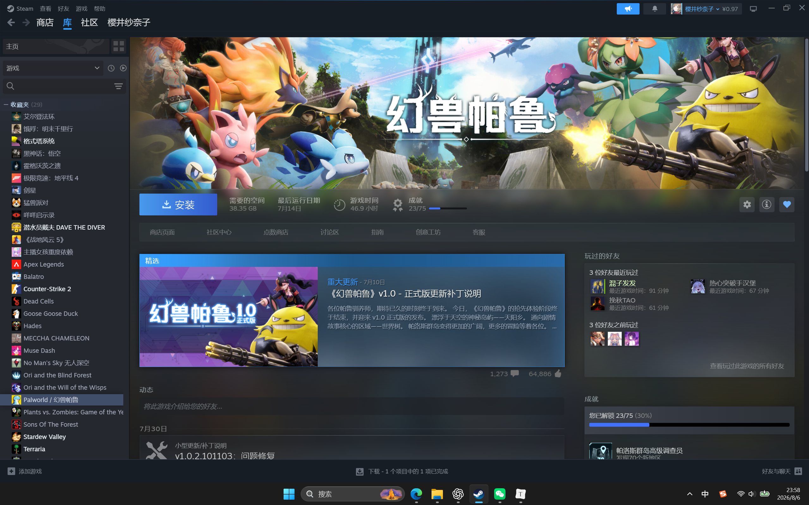

目前比较主流的开发 Agent 包括：

- [Codex](https://openai.com/zh-Hans-CN/codex/)（桌面端和 CLI）
- [Claude Code](https://claude.com/product/claude-code)（桌面端和 CLI）

很明显都需要大家首先会科学上网。（windows和mac都可以，对于linux上我一直使用vscode上的codex插件）

  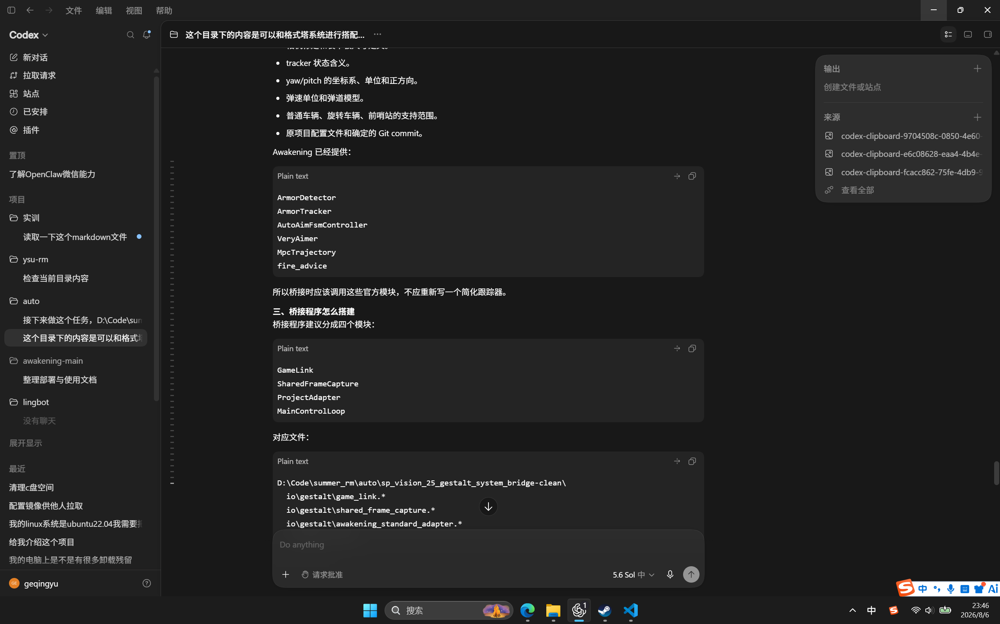
  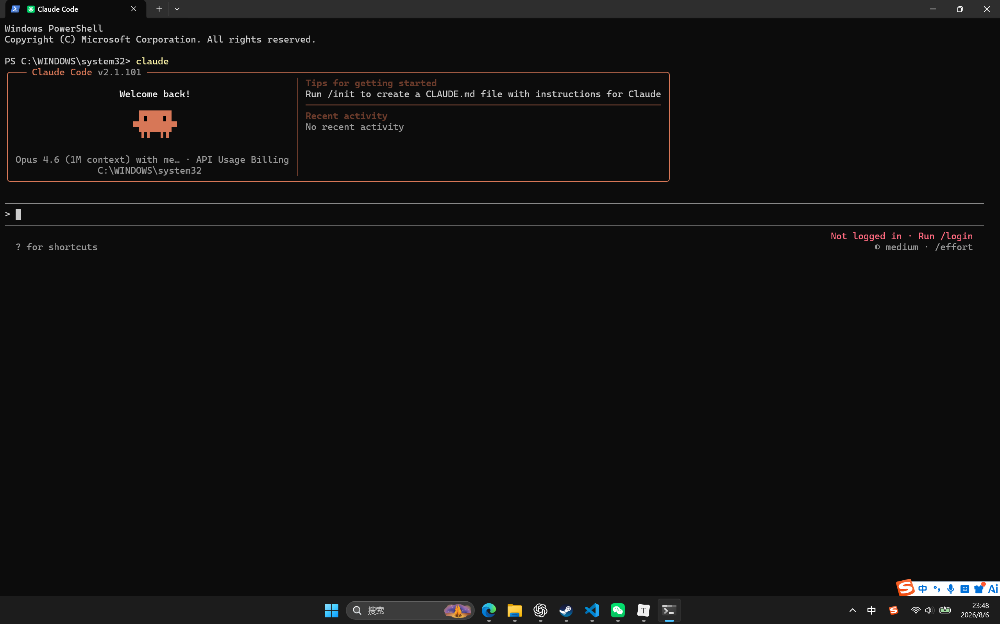
  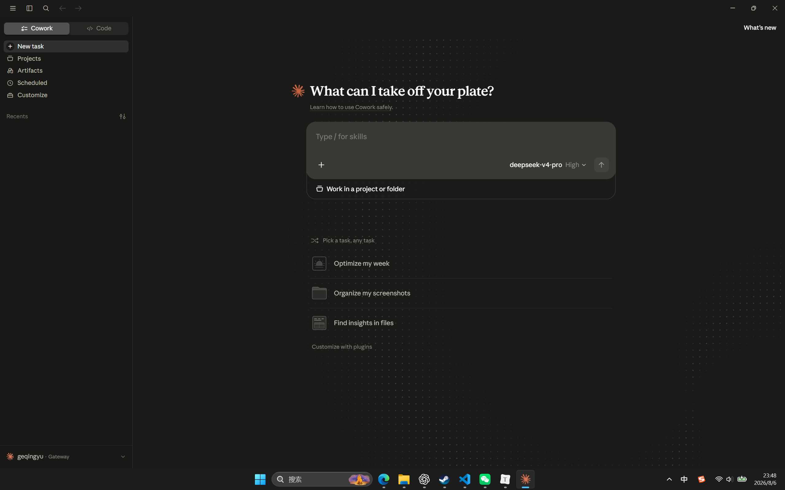

其他工具各有特点：

- **Trae**：适合作为入门工具，但需要关注实际调用的模型。（NPC）
- **WorkBuddy**：使用体验与 Trae 类似，并提供一定的免费额度。(NPC)
- **ZCODE**：对智谱自家模型和产品的适配更好，属于NPC吧。(NPC)
- **Cursor**：是优质的魔改版vscode，我最喜欢他使用AI做完项目由人来测试的方式，而且支付宝就能订阅，给到（夯）。
- **Copilot**：可以用于代码补全和临时救急，但完整 Agent 工作流相对有限。（NPC）
- **OpenCode**：开源伟大，模型接口多，需要配置。（人上人）

大家如果不想在模型这里多掏一些米的话，就乘着deepseek的春风也没问题。

那随着梁圣的deepseek-v4-flash-0731正式版的发布，目前能用的国内模型有且仅有KIMI k3（消耗巨大，前端最强，据说有一天烧了一个月额度的），千问3.8 MAX（听说不错没有亲身使用） 和deepseek -v4-flash-0731（妈妈，我终于用到便宜好用的AI了）。（之于所谓的deepseek斩杀线就是这样的，智谱全面小丑🤡，小米的mimo斩杀，minimax斩杀等等）

  

比较遗憾是deepseek没有多模态。

那对于我来讲OpenAI对于中国的态度是比A#要松很多的，我们可以通过一些手段拿到Gpt的订阅，但是很难拿到稳定的claude的订阅（检测到CN的IP立马封）而且两家属于只能使用自己的模型。

工具本身依然非常有价值。目前最省钱的deepseek的接口文档给出了比较广泛的agent接入方法https://api-docs.deepseek.com/zh-cn/quick_start/agent_integrations/claude_code

例如，[CC Switch](https://github.com/farion1231/cc-switch) 可以帮助管理不同模型与 Agent 工具之间的配置。

  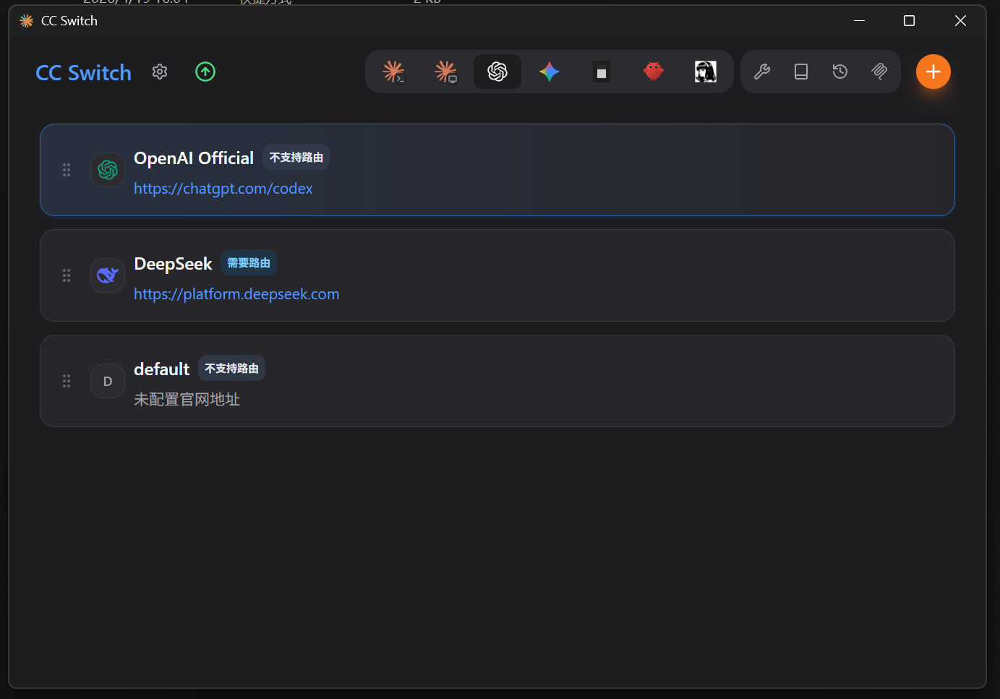
  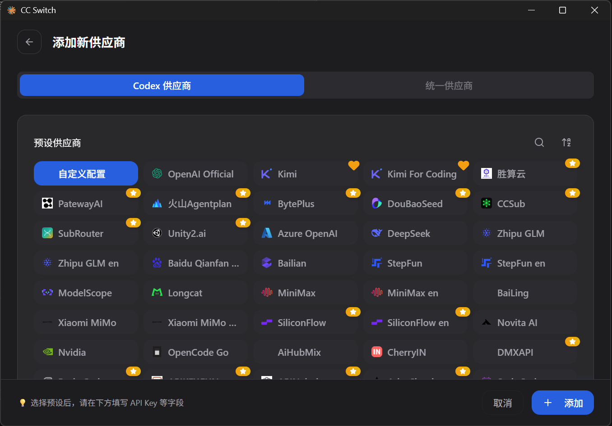

此外，还有 Cherry Studio 等通用 AI 客户端。

那我自己平时使用的Claude模型主要出自于中转站，价格可能偏高，所以也是偶尔用用，用多少充多少。这里大家注意如果要使用中转站，注意自己的金钱安全！

---

## 我的 AI 使用方法

随着模型能力不断提高，很多人认为提示词工程的重要性正在下降。模型确实越来越懂你意思，但作为自然语言模型，提示词还是生产的基础。

我尤其看重上下文对 AI 输出质量的影响。开发项目时，我会尽可能将项目拆成较小的模块。每完成一个模块，就及时结档，并将当前状态与目标文档进行对比，然后开启下一段对话。

新对话开始时，我会先告诉 AI 刚刚完成了什么，请它检查项目现状并进行评估。在 AI 给出方案后，我会先检查方案。如果涉及不熟悉的领域，还会让另一个模型进行独立分析，通过交叉验证和互相纠错得到更可靠的方案，再以方案为大纲继续开发。

这种方法表面上增加了部分 Token 消耗，但减少了 Bug、返工和项目结构被打乱的概率。由于每段对话都会及时结档，不会形成过长的上下文，模型的响应效率也能保持稳定。从完整项目的角度看，反而节省 Token。

除了提示词，我也很重视 Agent 的另一个重要领域：**Skill 和插件**。

我的理解是：通用模型像一个基础扎实、学习能力很强985的毕业生，春风满面。而 Skill 更像一位在特定领域经验丰富的成熟老练的专家，容光焕发。让通用模型按照专业 Skill 的流程工作，可以显著提高特定任务的完成质量。

我主要通过以下渠道了解 Skill：

- [Skills.sh](https://www.skills.sh/)
- [GitHub](https://github.com/)

  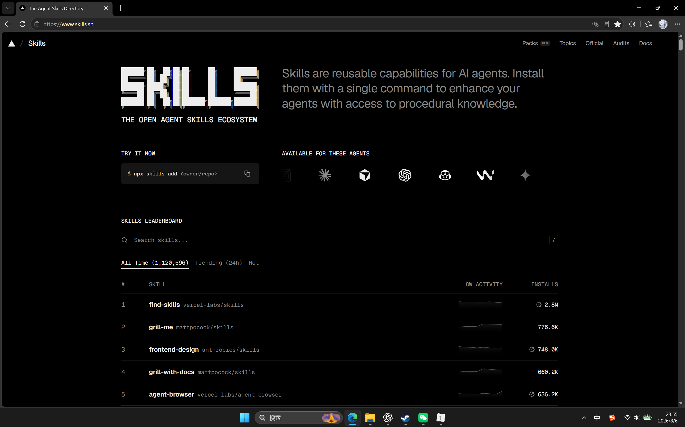
  
  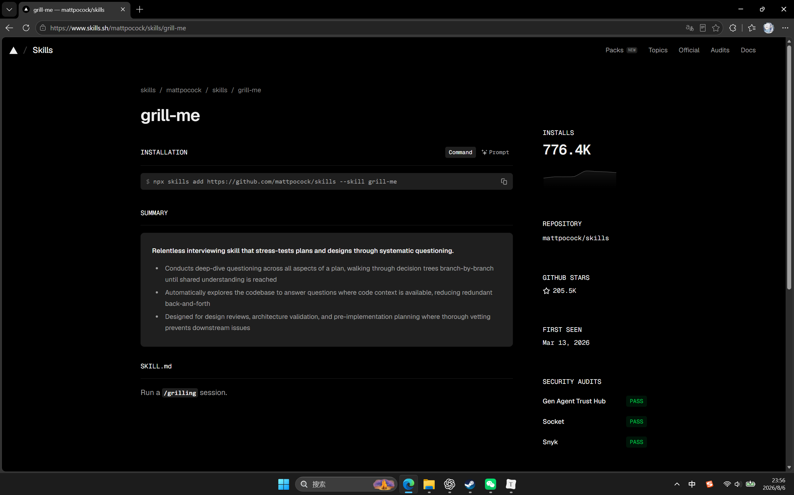

  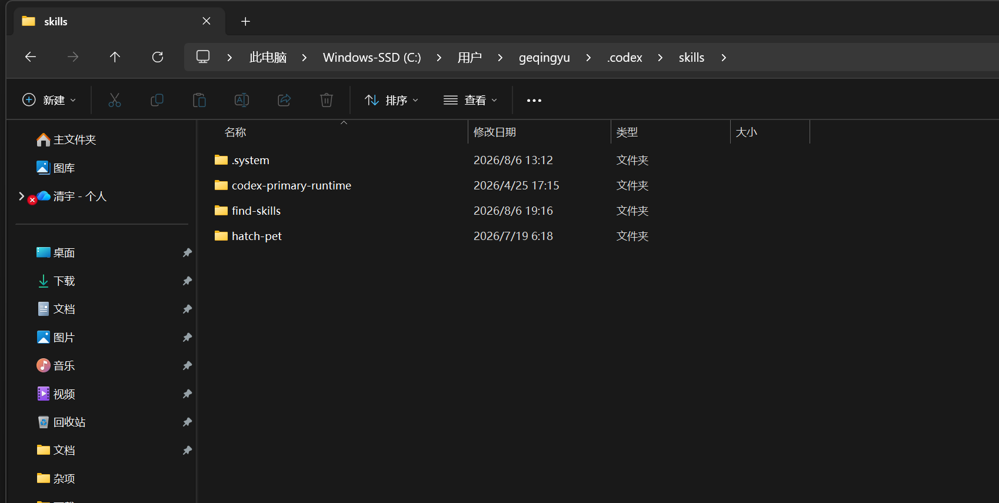
  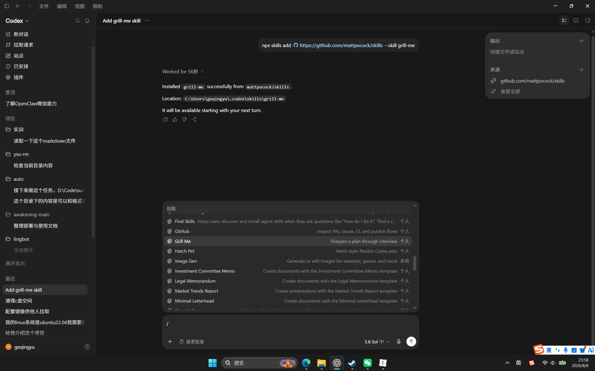
  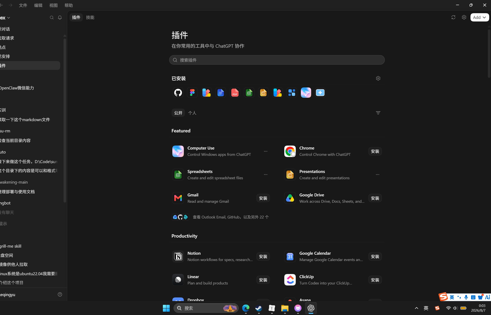

为 Agent 安装合适的 Skill，可以补充专业知识、固定工作流程，并提高结果的稳定性。

---

## 我的分享总结

AI 不应该取代人的判断，而应该成为放大个人能力的工具。真正有效地使用 AI，需要同时理解模型能力、提示方式、上下文管理、结果验证和工具权限。

本文的核心观点可以归纳为以下几点：

1. **模型能力决定上限。**不同模型在编程、推理、图像、搜索和长文本处理方面各有所长，应根据任务选择合适的模型。
2. **上下文质量决定 AI 能否理解任务。**清楚说明目标、项目背景、限制条件、输出格式和实际反馈，比堆砌华丽的提示词更重要。
3. **工作流决定结果是否可靠。**有效流程不是让 AI 一次完成全部工作，而是“提供资料 → 拆分任务 → 执行 → 验证 → 反馈 → 继续修改”。
4. **验证不能省略。**AI 会产生幻觉，也可能误解接口、版本、数据和需求；重要结果必须通过官方资料、实际运行或多模型交叉验证进行确认。
5. **项目需要分阶段管理。**及时结档、总结当前状态并开启新对话，可以减少上下文混乱、返工和无效 Token 消耗。
6. **Agent、Skill 和插件能够扩展模型能力。**Agent 负责执行任务，Skill 提供专业流程，插件连接外部工具；能力越强，越要注意最小权限、操作确认和数据安全。
7. **工具只是手段。**Codex、Claude Code、Cursor 等工具各有优势，但最终效果仍取决于使用者能否把项目讲清楚、把任务拆清楚、把错误反馈清楚。

> **AI 时代真正重要的能力，不只是会不会使用某个工具，而是能否提出清晰的问题、组织可靠的上下文、验证生成的结果，并始终保留自己的思考与判断。**

